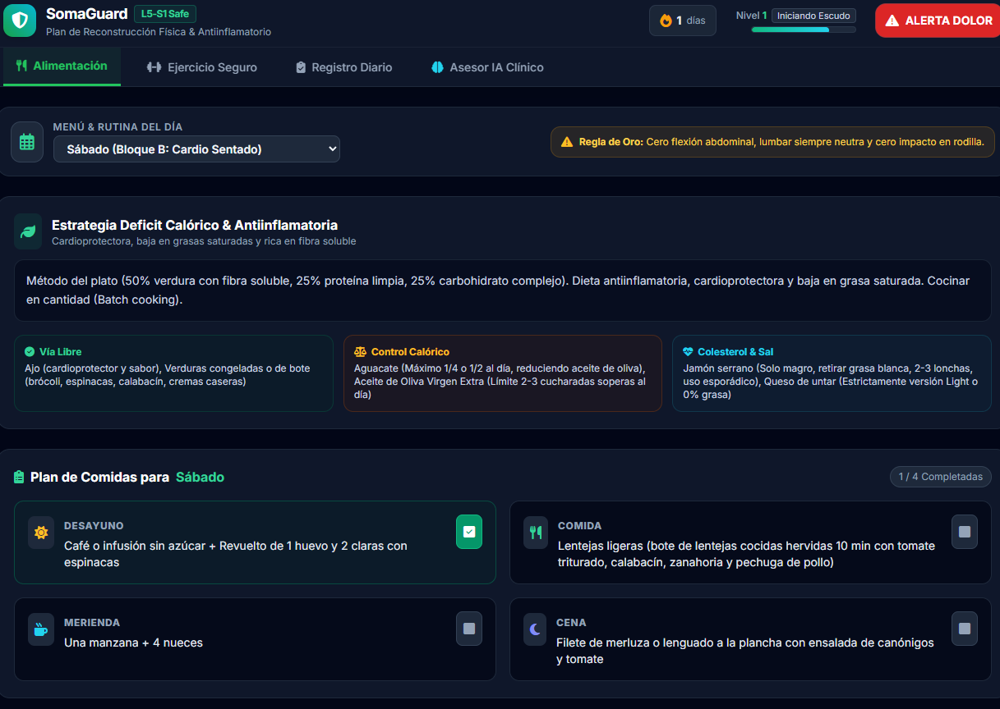

# 🛡️ SomaGuard L5-S1

**Asistente personal de salud. Local-first. Sin nube. Sin telemetría. Sin trackers.**

Una PWA (Progressive Web App) diseñada para gestionar un plan de reconstrucción física y antiinflamatorio para una condición específica: hernia discal L5-S1, lesión crónica de rodilla, colesterol alto y sobrepeso.

No es una app genérica de fitness. Es un **sistema operativo de autocuidado personal**, adaptado a un perfil clínico concreto.

---



---

## 📖 Índice

- [¿Qué es SomaGuard?](#qué-es-somaguard)
- [¿Qué resuelve?](#qué-resuelve)
- [Funcionalidades](#funcionalidades)
- [Cómo ejecutarla](#cómo-ejecutarla)
- [Cómo personalizarla para tu caso](#cómo-personalizarla-para-tu-caso)
  - [Opción A: Dar el código a una IA](#opción-a-dar-el-código-a-una-ia)
  - [Opción B: Editar el HEALTH_DATA a mano](#opción-b-editar-el-health_data-a-mano)
  - [Opción C: Importar/Exportar configuración](#opción-c-importarexportar-configuración)
- [Estructura del HEALTH_DATA](#estructura-del-health_data)
- [Roadmap](#roadmap)
- [Aviso médico](#aviso-médico)
- [Licencia](#licencia)

---

## ¿Qué es SomaGuard?

SomaGuard es un archivo HTML único que se abre en cualquier navegador y funciona como una aplicación completa.

No tiene servidor. No manda datos a ningún sitio. No tiene cuenta de usuario. Todo se guarda en tu navegador (LocalStorage), y puedes exportarlo a un archivo para llevarlo a otro dispositivo.

Se instala como PWA en el móvil, funciona sin conexión, y está diseñada para ser **personalizada por cualquier persona, para cualquier condición clínica**.

---

## ¿Qué resuelve?

Cuando tienes una condición crónica (hernia, lesión, sobrepeso, colesterol), te enfrentas a:

- **Confusión**: ¿qué ejercicios son seguros? ¿qué alimentos ayudan?
- **Falta de adherencia**: sin un sistema, abandonas a la semana.
- **Riesgo**: hacer un ejercicio incorrecto puede agravar la lesión.
- **Soledad**: los médicos dan pautas generales, no un plan diario.

SomaGuard te da:

- Un **plan nutricional diario** antiinflamatorio.
- Una **rutina de ejercicio adaptada** con prohibiciones explícitas.
- Un **motor clínico adaptativo** que modifica el plan según tu estado.
- Un **protocolo de emergencia** para cuando duele de verdad.
- Un **sistema de gamificación** para mantener la adherencia.

---

## Funcionalidades

| Módulo | Qué hace |
|:---|:---|
| 🍽️ **Alimentación** | Menú semanal, estrategia calórica, ingredientes permitidos. Checklist diario. |
| 🏋️ **Ejercicio Seguro** | Rutina adaptada por bloque, restricciones críticas, temporizador con audio. |
| 📋 **Registro Diario** | Check-in de dolor, estrés, movilidad y adherencia dietética. Historial completo. |
| 🧠 **Motor Clínico Adaptativo** | Recomendaciones dinámicas basadas en tus datos reales. |
| 🚨 **Protocolo de Emergencia** | Botón de pánico con guía de descompresión discal y crioterapia. |
| 🎮 **Gamificación** | XP, niveles, rangos personalizados y racha de días consecutivos. |
| ⚙️ **Backup y Config** | Exportación/importación completa de tu estado y datos clínicos. |

---

## Cómo ejecutarla

### Opción 1: Doble clic
1. Descarga el archivo `somaguard.html`.
2. Ábrelo con doble clic en cualquier navegador moderno.
3. Funciona al instante.

### Opción 2: Instalar como PWA (recomendado)
1. Abre el archivo en Chrome, Edge o Safari (móvil o escritorio).
2. Espera unos segundos. Aparecerá el aviso de "Instalar aplicación".
3. Pulsa "Instalar".
4. Ya tienes SomaGuard como app nativa en tu móvil o escritorio, funcionando offline.

### Opción 3: Subir a un servidor
Puedes subir el HTML a GitHub Pages, Netlify o Vercel. Eso te permite acceder desde cualquier dispositivo vía URL. Pero recuerda: **los datos siguen siendo locales a cada navegador**. Para sincronizar entre dispositivos, usa el export/import de configuración.

---

## Cómo personalizarla para tu caso

SomaGuard no es una app cerrada. Es un esqueleto que puedes adaptar a cualquier condición clínica. Aquí tienes tres formas, de más fácil a más flexible.

### Opción A: Dar el código a una IA

**La más rápida y accesible.**

1. Copia todo el contenido del archivo `somaguard.html`.
2. Abre una IA de tu confianza (Claude, ChatGPT, Gemini, DeepSeek...).
3. Pega el código y añade un mensaje como este:

```text
Te paso el código de mi app de salud personal. Está diseñada para
alguien con hernia L5-S1, lesión de rodilla y colesterol alto.
Quiero adaptarla a mi caso concreto:
Mi condición: [describe tu patología]
Mis restricciones: [describe lo que NO puedes hacer]
Mi objetivo: [describe qué quieres conseguir]
Alergias o intolerancias alimentarias: [describe]
Nivel de actividad actual: [sedentario/activo/deportista]
Por favor, modifica SOLO el objeto HEALTH_DATA y el motor
de razonamiento clínico. Mantén la estructura y el diseño.
```

4. La IA te devolverá un HTML adaptado a tu caso.
5. Guárdalo, ábrelo, y ya tienes tu SomaGuard personal.

**Por qué funciona:** SomaGuard está diseñado para que toda la lógica clínica esté concentrada en `HEALTH_DATA`. Un modelo de lenguaje bien dirigido puede reescribirlo sin tocar el resto del código.

### Opción B: Editar el HEALTH_DATA a mano

Si prefieres control total, abre el HTML en un editor de texto y busca la constante `DEFAULT_HEALTH_DATA`. Ahí están todas las variables que puedes modificar:

- **Estrategia general** de nutrición.
- **Pautas de ingredientes** permitidos/prohibidos.
- **Menú semanal** (desayuno, comida, merienda, cena por día).
- **Bloques de ejercicio** (A, B, C) con días, objetivos, ejecución, pautas y progresiones.
- **Restricciones críticas** (prohibiciones innegociables).

**Consejo:** si no sabes qué poner, pídele a tu médico o fisioterapeuta un plan y transcríbelo tal cual. SomaGuard es una herramienta de adherencia, no un sustituto de la prescripción clínica.

### Opción C: Importar/Exportar configuración

Una vez dentro de la app:
1. Pulsa el icono ⚙️ (arriba a la derecha, junto al botón de pánico).
2. Se abre un modal con dos botones:
   - **Exportar**: descarga un archivo `.json` con tu estado completo (`userState`) y tu configuración clínica (`HEALTH_DATA`).
   - **Importar**: carga un archivo `.json` previamente exportado.

**Para qué sirve:**
- **Cambiar de dispositivo**: exportas en el móvil, importas en el portátil.
- **Compartir tu configuración**: le pasas el JSON a alguien con tu misma condición.
- **Versionar tu plan**: guardas cada iteración con fecha, por si quieres volver a una anterior.

---

## Estructura del HEALTH_DATA

Aquí tienes el esqueleto del objeto que define todo el comportamiento clínico de la app:

```javascript
{
  "usuario": {
    "condicion_fisica": { ... },
    "patologias_medicas": { ... }
  },
  "restricciones_criticas_ejercicio": [ ... ],
  "plan_ejercicios_ciclico": {
    "bloque_a_...": {
      "nombre_bloque": "...",
      "dias": ["Lunes", "Miércoles", "Viernes"],
      "frecuencia": "...",
      "ejercicios": [
        {
          "nombre": "...",
          "objetivo": "...",
          "ejecucion": "...",
          "pauta": "...",
          "progresion": "...",
          "duracion_seg": 10,
          "descanso_seg": 45,
          "series": 5
        }
      ]
    },
    "bloque_b_...": { ... },
    "bloque_c_...": { ... }
  },
  "plan_nutricional_deficit_calorico": {
    "estrategia_general": "...",
    "pautas_ingredientes_permitidos": { ... },
    "menu_semanal": {
      "Lunes": { "desayuno": "...", "comida": "...", "merienda": "...", "cena": "..." },
      ...
    }
  }
}
```

Modifica lo que necesites. Deja lo demás como está.

---

## Roadmap

### Completado
- ☑ Módulo de alimentación con checklist diario
- ☑ Módulo de ejercicio adaptado por bloques
- ☑ Registro diario con historial completo
- ☑ Motor clínico adaptativo con razonamiento
- ☑ Protocolo de emergencia de dolor
- ☑ Gamificación con XP, niveles y rangos
- ☑ Exportación/importación de estado y configuración
- ☑ PWA con Service Worker y manifest dinámico
- ☑ Timestamps reales para análisis histórico
- ☑ Racha calculada automáticamente

### Próximo
- □ Gráficas de evolución (dolor, estrés, adherencia) en el tiempo
- □ Análisis semanal automático (patrones, correlaciones)
- □ Recordatorios con notificaciones push
- □ Modo multiusuario (varios perfiles clínicos en la misma app)
- □ Integración con Apple Health / Google Fit (opcional)

### Futuro
- □ Motor de IA real con RAG sobre historial y guías clínicas
- □ Sincronización cifrada entre dispositivos (E2E)
- □ Exportación de informes para el médico
- □ Traducción a otros idiomas

---

## Aviso médico

SomaGuard no es un dispositivo médico. No diagnostica, no trata, no sustituye la consulta con un profesional sanitario.

Es una herramienta de adherencia y organización personal. Todo el contenido clínico que incluye (nutrición, ejercicio, restricciones) debe ser revisado y validado por tu médico o fisioterapeuta antes de ponerlo en práctica.

El código está diseñado para que tú mismo (o tu profesional de confianza) pueda adaptarlo a tu caso concreto. Úsalo con responsabilidad.

---

## Licencia

MIT. Haz lo que quieras con esto. Si te sirve, bien. Si lo mejoras, mejor. Si lo adaptas a tu caso, me encantará saberlo.

---

## Autor

**Pedro Mencías** — @Charran78  
Desarrollador de soluciones, arquitecto de sistemas, autor de Bits To The Bone.  
Escribo sobre IA local, soberanía de datos y software que se puede tocar.  
🌐 Portfolio: [pedromencias.netlify.app](https://pedromencias.netlify.app)  
💼 LinkedIn: [linkedin.com/in/pedro-mencías](https://linkedin.com/in/pedro-mencías)

> *"La mejor app de salud no es la más bonita. Es la que usas sin pensar."*#   S O M A - G u a r d 
 
 